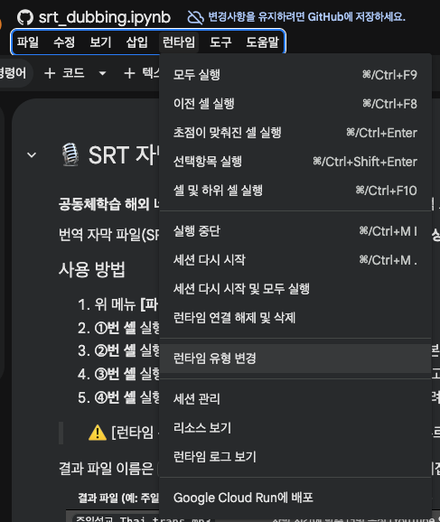
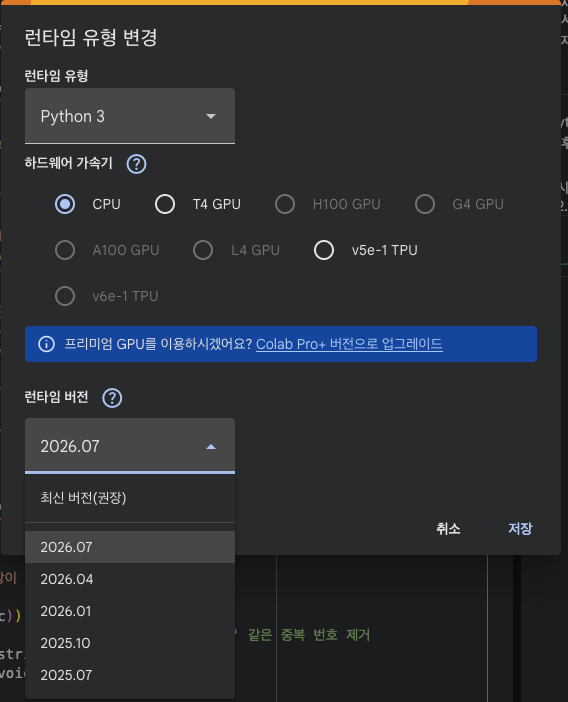

# 🎙️ dubbing — SRT 자막 → 다국어 더빙

번역 자막 파일(SRT) 하나로 **자막 시간에 맞춘 더빙 음성**과 **더빙 영상**을 만드는 Colab 노트북입니다. 코딩은 필요 없습니다.

  

<b>👆 버튼을 눌러 Colab에서 바로 열기</b>

## 런타임 설정 (선택)
이 노트북은 GPU 없이 기본 런타임(CPU)으로 실행됩니다. 실행이 안 되면 메뉴 **[런타임 → 런타임 유형 변경]** 에서 **런타임 버전**을 **2026.07** 로 바꾸고 **[저장]** 을 누르세요.

<table>
  <tr>
    <td align="center"><b>① [런타임 → 런타임 유형 변경]</b></td>
    <td align="center"><b>② 런타임 버전 2026.07 선택 → [저장]</b></td>
  </tr>
  <tr>
    <td></td>
    <td></td>
  </tr>
</table>

## 사용 방법
1. 위 버튼으로 노트북을 열고 **[파일 → 드라이브에 사본 저장]**
2. **①번 셀** 실행 (프로그램 설치)
3. **②번 셀** 실행 → SRT 파일(필수)과 원본 영상 MP4(선택) 업로드
4. **③번 셀** 실행 → 목소리·속도 선택 후 **[💾 설정 저장]**
5. **④번**(더빙 생성) → **⑤번**(영상 합성) → **⑥번**(내려받기) 실행

> ⚠️ [런타임 → 모두 실행]은 쓰지 마세요. ③번에서 버튼을 누르기 전에 ④번이 실행되면 멈춥니다.
>
> ⚠️ AI 음성은 '초안'입니다. 배포 전 반드시 원어민이 끝까지 듣고 확인하세요.
